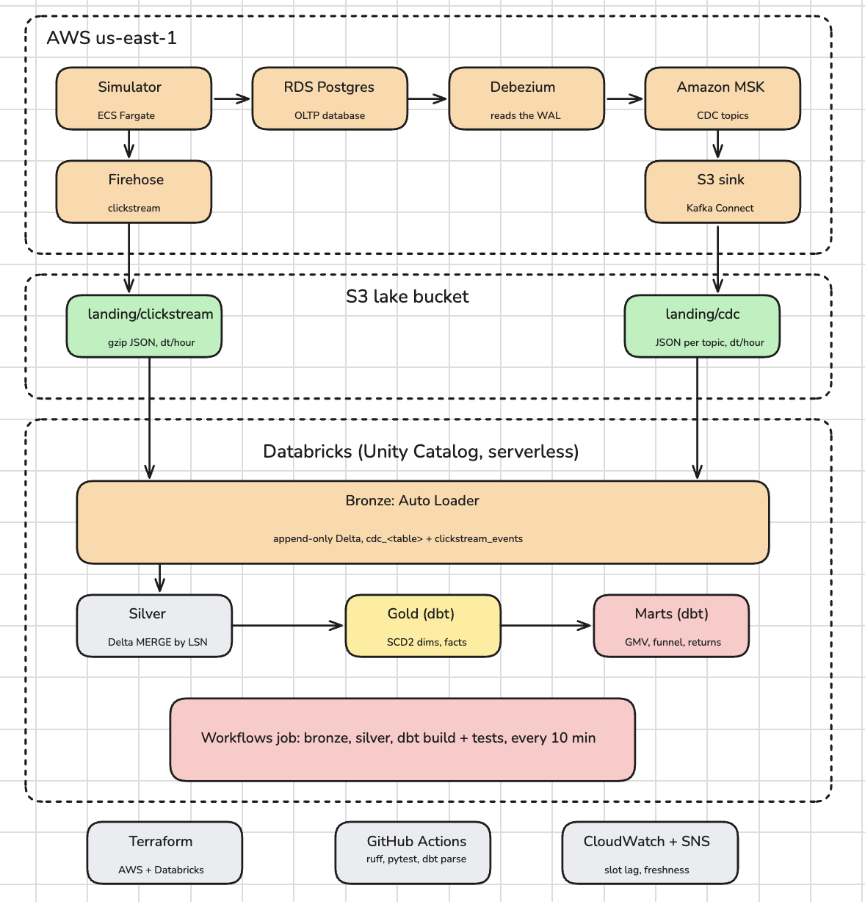

# ecommerce_analytics_platform

A data pipeline for a made-up online fashion store. A small simulator places orders, ships them, handles returns and restocks inventory in Postgres. Every change in that database is picked up from the Postgres log, landed in S3, and turned into reporting tables in Databricks.

I built it to practice change data capture, Delta Lake merges and dimensional modeling with dbt.



## How it works

1. **Simulator** (`simulator/`) writes orders, payments, returns and inventory updates into Postgres. It also sends clickstream events (product views, add to cart, checkout steps) to Firehose. `--sale` turns on 10x traffic and a product that sells out.
2. **Debezium** reads the Postgres write-ahead log and publishes every insert, update and delete to Kafka (MSK). The analytics side never runs queries against the app database.
3. **Kafka Connect S3 sink** writes those changes to S3 as JSON files, one folder per table, split by date and hour. Firehose does the same for clickstream.
4. **Bronze** (`lakehouse/bronze.py`): Auto Loader picks up new files into append-only Delta tables.
5. **Silver** (`lakehouse/silver.py`): a Delta MERGE applies the changes. Each table gets a `_current` version (latest row per key) and a `_changes` version (full history).
6. **Gold and marts** (`dbt/`): a star schema with customer and product dimensions that keep their history (SCD type 2), order/return/session facts, and four marts: daily GMV, funnel, returns by size, and stock-outs.
7. A Databricks job runs bronze, silver and `dbt build` every 10 minutes.

## Run it locally

Needs Docker and uv.

```bash
docker compose up -d
uv run python simulator/simulator.py --rate 2
```

This starts Postgres, Kafka and Kafka Connect with Debezium. Changes show up in Kafka topics `shop.public.<table>`. To also write them to S3, put `LAKE_BUCKET=<bucket>` in `.env` and restart the `connect` container.

Tests:

```bash
uv run pytest tests
```

## Deploy

All infrastructure is Terraform in `infra/`, with state stored in the S3 bucket.

| Stack        | What's in it                                                                                |
| ------------ | ------------------------------------------------------------------------------------------- |
| `persistent` | VPC, Firehose, ECR repos, SNS alerts. No hourly cost.                                       |
| `session`    | RDS Postgres, MSK, Fargate services for the simulator and Kafka Connect. Destroy after use. |
| `databricks` | Unity Catalog access to the bucket, schemas, the pipeline job.                              |

```bash
terraform -chdir=infra/<stack> init -backend-config="bucket=<bucket>"
terraform -chdir=infra/<stack> apply
```

On Databricks Free Edition, create the `ecommerce` catalog in the UI first. Free Edition doesn't allow creating it through the API.

## Stack

Postgres, Debezium, Kafka (MSK), Kafka Connect, Kinesis Firehose, S3, Databricks (Auto Loader, Delta Lake, Unity Catalog, Workflows), dbt, Terraform, GitHub Actions.
